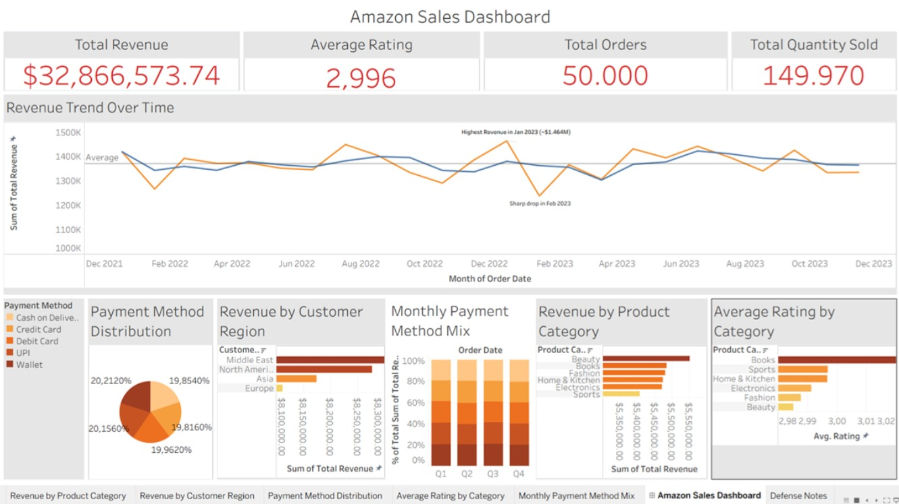
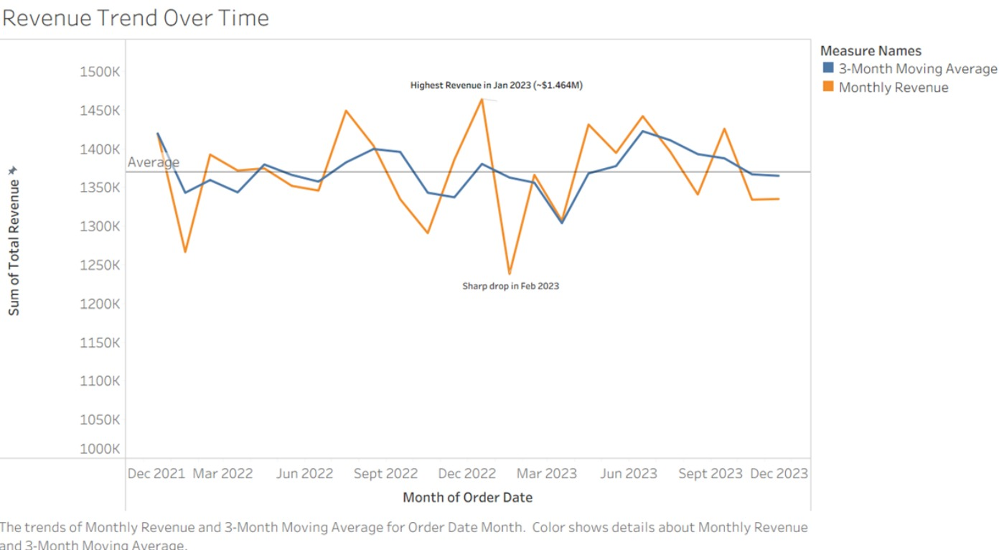
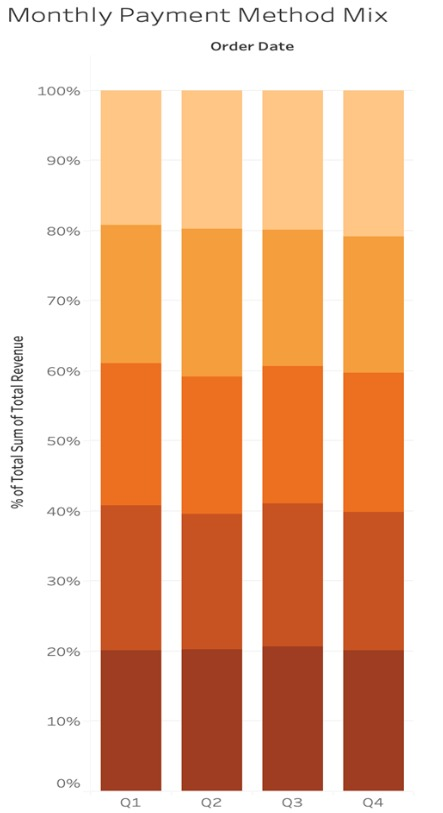

# Amazon Sales Data Visualization Dashboard

An interactive Tableau dashboard designed to analyze temporal sales patterns, payment method compositions, regional performance, and product category metrics across an Amazon sales dataset (January 2022 – December 2023).

## 📁 Dataset

* **Source:** [Amazon Sales Dataset on Kaggle](https://www.kaggle.com/datasets/aliiihussain/amazon-sales-dataset)
* **Scope:** 50,000 orders (January 2022 – December 2023)

## 📊 Executive Overview

The dashboard provides business managers, sales executives, and operational decision-makers with a unified view of overall business performance, bridging high-level KPIs with granular dimensional breakdowns.

### Key Performance Indicators (KPIs)

* **Total Revenue:** \$32,866,573.74
* **Average Rating:** 2.996
* **Total Orders:** 50,000
* **Total Quantity Sold:** 149,970

## 🏗️ Dashboard Architecture & Visual Flow

The dashboard follows a **progressive disclosure** hierarchy—moving from macro-level summaries to historical context and micro-level breakdowns—to prevent cognitive overload:

1. **Top Layer — Executive KPIs (Macro View)**
   * Four isolated scorecard cards displaying Total Revenue, Average Rating, Total Orders, and Total Quantity Sold for an immediate snapshot of business scale.

2. **Middle Layer — Temporal Trends (Contextual View)**
   * **Revenue Trend Over Time:** A full-width continuous line chart tracking monthly revenue alongside a 3-Month Moving Average and an overall average reference line (\~\$1.36M).

3. **Bottom Layer — Dimensional Breakdowns (Micro View)**
   * **Payment Method Distribution:** Pie chart showing overall share across Cash on Delivery, Credit Card, Debit Card, UPI, and Wallet.
   * **Revenue by Customer Region:** Horizontal bar chart comparing sales across Middle East, North America, Asia, and Europe.
   * **Monthly Payment Method Mix:** 100% stacked bar chart tracking quarterly part-to-whole payment proportions.
   * **Revenue by Product Category:** Horizontal bar chart ranking categories (Beauty, Books, Fashion, Home & Kitchen, Electronics, Sports).
   * **Average Rating by Category:** Horizontal bar chart evaluating customer satisfaction across product segments.

## 🎨 Key Design Decisions

### Time-Series Design

* **Continuous Time Axis:** Preserves chronological flow and uniform spacing between months.
* **Smoothing & Benchmarks:** A 3-month moving average reduces short-term noise, while a horizontal average reference line provides an immediate baseline for above/below-average months.
* **Selective Annotations:** Highlights critical anomalies, such as the peak revenue in **January 2023 (\~\$1.464M)** and the sharp drop in **February 2023**.

### Composition & Proportion

* **100% Stacked Bar Chart:** Isolates pure compositional shifts in payment methods across quarters (Q1–Q4) without distortion from total revenue volume changes.
* **Consistent Ordering & Palette:** Uses a sequential orange-to-brown palette ordered consistently from darkest (Wallet) to lightest (Cash on Delivery) to aid visual tracking.

### Multi-View Coordination
* **Cross-Filtering & Highlighting:** Clicking a payment method, region, or product category dynamically filters and highlights related metrics across the KPI cards and trend chart.
* **Horizontal Bar Charts:** Chosen for categorical and regional views so long labels (e.g., *Home & Kitchen*, *Middle East*) remain legible without text truncation or slanting.

## 💡 Key Insights

* **Stable Revenue with Seasonal Fluctuations:** Monthly revenue fluctuates between \~\$1.2M and \~$1.5M, showing periodic peaks (August 2022, January 2023, July 2023, October 2023) and recurring dips in February.
* **Balanced Payment Mix:** All five payment methods contribute almost equally (\~19.8%–20.2% each), with minimal quarter-to-quarter compositional shift.
* **Regional & Category Opportunities:** While overall revenue is steady, clear performance differences exist across customer regions, product categories, and category-level customer ratings—highlighting targeted areas for business optimization.

## 🛠️ Tools & Technologies

* **Tableau** (Data Visualization, Dashboard Design, Table Calculations, Interactive Filtering)
